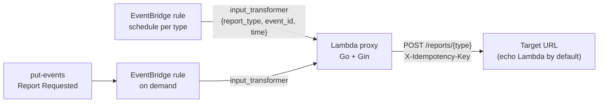

# eventbridge-lambda-proxy

EventBridge triggers a Go + Gin Lambda with a report type (`a`, `b`, ...), and the Lambda forwards it over HTTP to a target URL. The question: can one small Lambda turn scheduled and on-demand EventBridge events into HTTP calls to a report service, with retries and duplicate protection?

| | |
|---|---|
| Status | Tested on floci (local AWS emulator), not yet on AWS |
| Region | ap-southeast-1 (Singapore) |
| Services | EventBridge (rules), Lambda (provided.al2023, arm64), Lambda Function URL (echo target), CloudWatch Logs, IAM |
| Cost | Nothing on floci. On AWS: free tier covers this volume (estimate, not billed). Nothing stays up after `terraform destroy` |
| Date | 2026-10-28 |

## Goal

Trigger report `a` and `b` on a schedule and on demand, pass the report type as a parameter, and have the Lambda POST it to `<target_url>/reports/<type>`. A good answer: both trigger paths reach the target in one payload shape, unknown types never reach the target, and target failures are retried with a key the target can use to drop duplicates.

## Architecture



## Flow

1. A schedule rule fires (one rule per report type, e.g. `a` every 5 minutes), or someone sends a `Report Requested` event with `detail.report_type` (`scripts/trigger.sh a`).
2. The rule's `input_transformer` turns the event into one shape: `{"report_type":"a","event_id":"<EventBridge id>","time":"...","trigger":"schedule|on_demand"}`. The on-demand rule only matches report types in the allowlist.
3. EventBridge invokes the Lambda asynchronously.
4. The handler builds an HTTP request `POST /reports/a` and runs it through the Gin engine in memory (`engine.ServeHTTP`). The same engine runs as a normal HTTP server when started outside Lambda.
5. The Gin route checks the type against `REPORT_TYPES`, then POSTs the payload to `TARGET_URL/reports/a` with `X-Idempotency-Key: <event_id>` and `X-Report-Type: a`, with a timeout of `TARGET_TIMEOUT` (10 s, under the Lambda's 30 s).

Failure paths:

| What failed | Handler result | What happens |
|---|---|---|
| Target 5xx, 429, timeout, connection error | returns an error | Lambda async retry, up to 2 more times (`maximum_retry_attempts = 2`, max event age 1 h). Same event id, so the same idempotency key |
| Unknown report type, other 4xx, empty type | logs `dropped event, not retryable`, returns nil | No retry. A retry would fail the same way |
| All retries used | — | Event is dropped. No DLQ or on-failure destination in this POC |

## Trade-offs and alternatives

| Decision | Chosen | Alternatives | Trade-off |
|---|---|---|---|
| HTTP layer inside Lambda | Gin engine called with `ServeHTTP` and a recorder | Plain handler with `net/http` client; `aws-lambda-go-api-proxy` | Gin was asked for and lets the same routes run locally as a server. For one route it adds little, and makes the binary bigger: proxy 13 MB vs echo 5.6 MB, stripped. How much of that is Gin is an estimate; the proxy also links the HTTP client and `httptest`. The api-proxy adapter does not help: it only accepts API Gateway, ALB and Function URL events, not EventBridge |
| Trigger | EventBridge rules (schedule + event pattern) | EventBridge Scheduler | Rules handle both schedule and on-demand events in one place and support `input_transformer`. Scheduler has time zones, one-off schedules, its own retry and DLQ, and can pass `<aws.scheduler.execution-id>` as the key, but on-demand events would still need a rule, so two services to run |
| Passing the report type | `input_transformer` per rule | Static `input` on the rule; reading the raw event in Go | Static `input` replaces the whole event and loses the event id needed for idempotency. The transformer keeps one payload shape for both triggers, at the cost of template syntax that differs between AWS and floci (see Findings) |
| Error semantics | Error only for retryable failures | Error on every failure; synchronous invoke | Retrying a 400 wastes two invocations and gives the same result. The cost: non-retryable failures are only visible in logs, not in a failure destination |
| Duplicate delivery | Forward the EventBridge id as `X-Idempotency-Key` | Dedupe in the Lambda (needs a store such as DynamoDB) | Lambda async delivery is at-least-once. The proxy stays stateless, but the target must dedupe on the key, and the echo target does not |
| Allowlist | On-demand rule pattern and the Gin route both check the type | Only one check | Two places to keep in sync, but Terraform feeds both from `report_schedules`, and a direct `lambda invoke` cannot bypass the route check |
| Test target | Echo Lambda behind a public Function URL (`NONE` auth) | `target_url` to a real service; IAM-auth URL | Self-contained and logs `delivery_ms`. The URL is public while deployed. It only echoes, and destroy removes it |
| Runtime | `provided.al2023`, arm64, `-tags lambda.norpc` | `go1.x` (retired); x86_64 | Current Go runtime path. arm64 is listed cheaper per GB-s (from memory, price not checked). Needs a build step before `terraform apply` |

## Results

Functional, on floci (local emulator, Apple Silicon), 2026-10-28. Target was `scripts/local_target.py` at `host.docker.internal:9000` (`--fail-b` for the 503 row; see Findings for why not the echo Lambda).

| Check | Result |
|---|---|
| `go test -race ./...` (forward, header and body passthrough, unknown and path-traversal types, 5xx, 429, 4xx, timeout, unreachable target) | pass |
| On-demand `a` and `b` via `put-events` | both reached `/reports/a` and `/reports/b`, `X-Idempotency-Key` = EventBridge event id, `trigger = on_demand` |
| On-demand `c` (not in allowlist) | rule did not match, Lambda not invoked |
| Direct `lambda invoke` with `report_type = c` | logged `dropped event, not retryable`, nothing forwarded |
| Schedules at `rate(1 minute)` for 150 s | 3 deliveries each for `a` and `b`, `trigger = schedule` |
| Target returns 503 for `b` | handler returned `status 503` errors (n=3) |
| Async retry after the 503 | **not observed on floci**: no event id was delivered twice in 150 s |

Timing was not measured: floci latency does not carry over to AWS. To measure on AWS, use the `REPORT` lines in the proxy log (cold and warm duration) and `delivery_ms` in the echo log. Check the precision of the EventBridge `time` field first: if it is whole seconds, `delivery_ms` is off by up to about 1 s.

## Findings and limitations

- **Found:** floci inserted an unquoted placeholder (`"event_id": <id>`) raw, which produced invalid JSON and a Lambda `SyntaxError`. Quoted placeholders (`"event_id": "<id>"`) worked on floci. AWS docs say AWS quotes string values for unquoted placeholders and substitutes raw inside quotes, so the quoted form should work on AWS too. Not tested on AWS. Values here (ids, times, allowlisted types) contain no quotes.
- **Found:** inside floci the echo Lambda's Function URL resolves to `*.localhost:4566`, which a Lambda container cannot reach. The proxy logged `connection refused` and returned 502, which did exercise the error path.
- **Not tested:** anything on real AWS (the local AWS credentials were invalid on the test day), the echo Lambda and its Function URL end to end, Lambda async retries and their timing, cold start, concurrency, DLQ or on-failure destination, a target that needs auth.
- **Not tested:** the Function URL permissions. The provider docs say both statements are added on create. If the echo returns 403 on AWS, check the function policy has `lambda:InvokeFunctionUrl` (auth `NONE`) and `lambda:InvokeFunction` with `InvokedViaFunctionUrl`.
- **Unknown:** whether EventBridge Scheduler would be a better fit once time zones (e.g. `Asia/Bangkok` reports) matter. Not compared.

## Run

```bash
bash scripts/build.sh                      # build/proxy/bootstrap, build/echo/bootstrap

cd terraform
cp terraform.tfvars.example terraform.tfvars   # edit target_url / schedules
terraform init && terraform apply

../scripts/trigger.sh a ap-southeast-1     # on demand
aws logs tail /aws/lambda/poc-eb-lambda-proxy-proxy --follow --region ap-southeast-1
aws logs tail /aws/lambda/poc-eb-lambda-proxy-echo  --follow --region ap-southeast-1

terraform destroy    # always
```

On floci: `floci start && floci wait`, apply with `-var endpoint=http://localhost:4566 -var target_url=http://host.docker.internal:9000` and `python3 scripts/local_target.py` running on the host, export `AWS_ENDPOINT_URL=http://localhost:4566` (with `test`/`test` keys) before `trigger.sh`, then `terraform destroy -var endpoint=http://localhost:4566 && floci stop`.

Local dev without AWS: `cd app && TARGET_URL=http://localhost:9000 go run ./cmd/proxy`, then `curl -X POST localhost:8080/reports/a -H 'X-Idempotency-Key: k1' -d '{}'`.

## Files

| Path | Purpose |
|---|---|
| `app/internal/proxy/` | Gin engine (`server.go`), EventBridge-to-Gin adapter and retry rules (`event.go`), tests |
| `app/cmd/proxy/` | Lambda entry point; plain HTTP server when not in Lambda |
| `app/cmd/echo/` | Stand-in target for the Function URL; logs what arrived and `delivery_ms` |
| `terraform/` | Lambdas, IAM, log groups, schedule and on-demand rules with `input_transformer`, async retry config, floci endpoint switch |
| `scripts/build.sh` | Cross-compiles both binaries for arm64 |
| `scripts/trigger.sh` | Sends an on-demand `Report Requested` event |
| `scripts/local_target.py` | Target for floci runs; `--fail-b` answers 503 on `/reports/b` |
