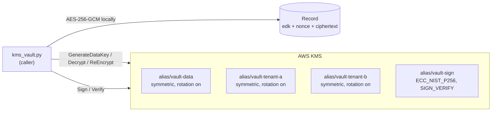
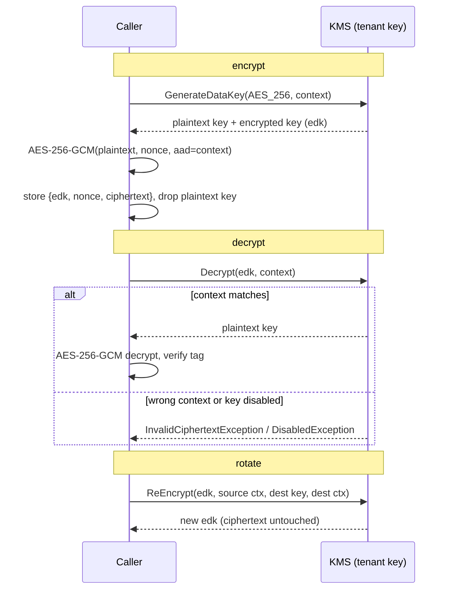

# kms-vault

Envelope encryption and signing on AWS KMS, as a small Python module with no API in front. The question: do KMS encryption context, key disable and re-wrapping behave the way a per-tenant design needs?

| | |
|---|---|
| Status | Tested on floci (local AWS emulator), not yet on AWS |
| Region | ap-southeast-7 (Thailand) |
| Services | KMS, IAM |
| Cost | Nothing on floci. On AWS: about $1 per key per month (4 keys), billable until the 7 day deletion window ends. ap-southeast-7 price not checked |
| Date | 2026-10-24 |

## Goal

Show the envelope-encryption pattern end to end and check four KMS behaviours: the encryption context binds a ciphertext to its tenant, a disabled key refuses use, `ReEncrypt` re-wraps without exposing the data key, and asymmetric keys sign and verify.

## Architecture



## Flow

Encrypt and decrypt. The plaintext data key exists only in the caller's memory, and only for the length of one operation.



| Function | KMS call | Notes |
|---|---|---|
| `encrypt(tenant, plaintext, context)` | `GenerateDataKey` | one KMS call regardless of payload size |
| `decrypt(record, context)` | `Decrypt` | context must equal the one used to encrypt |
| `rotate(tenant, record, context)` | `ReEncrypt` | data key never reaches the caller |
| `sign(message)` / `verify(message, signature)` | `Sign` / `Verify` | ECDSA_SHA_256 |

## Trade-offs and alternatives

| Decision | Chosen | Alternatives | Trade-off |
|---|---|---|---|
| Encrypt the payload | Envelope: `GenerateDataKey` plus local AES-GCM | Call KMS `Encrypt` directly | Direct `Encrypt` accepts only 4 KB, so a larger payload needs one KMS call per 4 KB chunk. Envelope is one call for any size, but the caller holds the plaintext data key in memory and owns the AES code |
| Crypto library | `cryptography` AES-GCM, written by hand | AWS Encryption SDK | The SDK adds key commitment, a standard message format and data key caching. Hand-written is short to read, easier to get wrong and not compatible with other tools |
| Tenant isolation | One key per tenant plus encryption context | One shared key with context only | Per-tenant keys can be disabled, audited and given a policy separately, but cost about $1 per key per month. Context alone is free, but one key policy covers everyone |
| Rotation | Automatic rotation plus `ReEncrypt` on demand | Decrypt then encrypt in the caller | `ReEncrypt` never exposes the data key. Automatic rotation keeps old ciphertext readable with no call |
| Record storage | Left to the caller (a dict of three byte strings) | DynamoDB; S3 | No size limit from the module. A DynamoDB item caps at 400 KB, so large records need S3 with only the encrypted key in a table |
| Test target | floci | Real AWS; LocalStack | Free and fast, and its KMS does real AES-GCM with context. It is an emulator, so latency and IAM enforcement do not carry over |

An earlier version put API Gateway, Lambda and DynamoDB in front of this. It added a 400 KB item limit and no new KMS behaviour, so it was removed.

## Results

Functional: `scripts/test_kms.py` passes 8 of 8 on floci.

| # | Check | Result |
|---|---|---|
| 1 | Round trip, 1 KB and 10 MB | original plaintext returned |
| 2 | Decrypt with a different encryption context | `InvalidCiphertextException` |
| 3 | Flip one ciphertext byte | AES-GCM `InvalidTag` |
| 4 | `ReEncrypt`, then decrypt | new encrypted key, same ciphertext, plaintext returned |
| 5 | Disable the key, decrypt, enable, decrypt | `DisabledException`, then works again |
| 6 | Sign and verify, then change the message | valid, then rejected |

Latency on floci 1.7.0, Apple Silicon, n=30, milliseconds:

| Payload | Op | Total median / p95 | KMS call | AES-GCM |
|---|---|---|---|---|
| 1 KB | encrypt | 1.8 / 2.5 | 1.8 | 0.02 |
| 1 KB | decrypt | 1.8 / 2.3 | 1.8 | 0.02 |
| 100 KB | encrypt | 2.0 / 2.8 | 2.0 | 0.04 |
| 100 KB | decrypt | 2.1 / 2.8 | 2.1 | 0.04 |
| 1 MB | encrypt | 1.8 / 2.2 | 1.6 | 0.18 |
| 1 MB | decrypt | 1.8 / 2.2 | 1.6 | 0.18 |
| 10 MB | encrypt | 4.4 / 4.8 | 2.5 | 1.95 |
| 10 MB | decrypt | 4.3 / 4.9 | 2.4 | 1.91 |

## Findings and limitations

- **Found:** payload size changes only the local AES step (about 0.19 ms per MB). The number of KMS calls stays at one per operation.
- **Found:** a wrong tenant is refused by KMS itself, before any plaintext data key is returned.
- **Not tested:** IAM and key-policy enforcement (a tenant A role denied on tenant B's key), CloudTrail auditing, concurrency, KMS request quotas.
- **Not measured:** real KMS latency. The KMS column is the emulator's, on localhost. Re-measure on AWS before drawing conclusions.
- **Not checked:** ap-southeast-7 KMS pricing.

## Run

```bash
python3 -m venv .venv && .venv/bin/pip install boto3 cryptography
floci start && floci wait
terraform -chdir=terraform init && terraform -chdir=terraform apply

cd scripts
AWS_ENDPOINT_URL=http://localhost:4566 ../.venv/bin/python test_kms.py
AWS_ENDPOINT_URL=http://localhost:4566 ../.venv/bin/python benchmark.py 30
cd ..

terraform -chdir=terraform destroy && floci stop    # always
```

For real AWS, apply with `-var endpoint=` and drop `AWS_ENDPOINT_URL`.

## Files

| Path | Purpose |
|---|---|
| `terraform/` | Four KMS keys with aliases (rotation on, 7 day deletion window) |
| `scripts/kms_vault.py` | The module: encrypt, decrypt, rotate, sign, verify |
| `scripts/test_kms.py` | Functional tests |
| `scripts/benchmark.py` | Latency by payload size, split into KMS and AES |
| `results/benchmark.csv` | Raw benchmark output |
