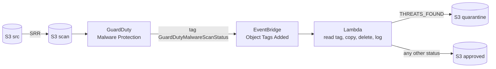

# poc-s3-guard-duty

Scan uploaded files with GuardDuty Malware Protection for S3, then route them to a quarantine or approved bucket. The question: how long does a file take from landing in S3 to its final bucket, and which step dominates?

| | |
|---|---|
| Status | Tested on AWS, torn down |
| Region | ap-southeast-7 (Thailand) |
| Services | S3, GuardDuty Malware Protection, EventBridge, Lambda (python3.12), IAM |
| Cost | GuardDuty scan: 1 GB and 1,000 requests per month free per Region. Everything else was pennies. Nothing is left running after `terraform destroy` |
| Date | 2026-10-24 |

## Goal

Build a scan-then-route pipeline with no servers, and measure the delay per step for files from 10 MB to 500 MB so the real bottleneck is known.

## Architecture



## Flow

1. A file is uploaded to the **source** bucket.
2. S3 Same-Region Replication (SRR) copies it to the **scan** bucket.
3. GuardDuty Malware Protection scans the new object and writes the tag `GuardDutyMalwareScanStatus`.
4. S3 emits `Object Tags Added` to EventBridge. A rule on the scan bucket triggers the Lambda.
5. The Lambda reads the tag. `THREATS_FOUND` goes to **quarantine**, anything else goes to **approved**. It copies with the tags, deletes the object from the scan bucket and logs filename, path, status and destination as JSON.

Failure path: if the Lambda fails, EventBridge retries asynchronously after about 60 s and again after about 120 s. A first-file outlier of 210 s came from two failed invocations plus those retries.

## Trade-offs and alternatives

| Decision | Chosen | Alternatives | Trade-off |
|---|---|---|---|
| How a file reaches the scan bucket | SRR from src to scan | Upload straight to the scan bucket; S3 Replication Time Control (RTC) | SRR is the largest step (22 to 43 s, no SLA) and was 65 to 89% of the total. Uploading straight to scan removes it but gives up the separate landing bucket. RTC adds a 15 minute SLA, not speed |
| Trigger after the scan | EventBridge on `Object Tags Added` | GuardDuty's own scan-result event; polling the tag | Tag events fire for any tag change on the bucket, so the Lambda must check the tag. The scan-result event was not tested |
| Routing | Lambda `copy_object` then delete | Step Functions; S3 Batch Operations; leave in place and use tags | Simple and cheap, but the copy grows with size (about 1 s at 10 MB, 9 s at 500 MB) and the Lambda needs a 300 s timeout for large files |
| Unknown or failed scan status | Treated as approved | Treat anything but `NO_THREATS_FOUND` as quarantine | The POC routes only `THREATS_FOUND` to quarantine. A real system should fail closed |
| Existing objects | Scan only new objects | Re-upload to trigger a scan | GuardDuty does not scan retroactively. Objects uploaded before the plan is ACTIVE are never scanned, so warm up with a throwaway file |
| Versioning | On for all buckets | Off | Needed by SRR. The Lambda must delete by version id, otherwise old versions stay in the scan bucket |

## Results

One run per size, polled every 0.2 s from the client, so values are accurate to about 1 s. Seconds.

| File | Replication | GuardDuty scan | Lambda move | Total |
|---|---|---|---|---|
| 10 MB | 22.3 | 1.7 | 1.1 | 25.1 |
| 30 MB | 21.9 | 2.2 | 2.3 | 26.5 |
| 50 MB | 22.1 | 2.9 | 2.3 | 27.2 |
| 100 MB | 21.7 | 43.3 | 3.5 | 68.5 |
| 150 MB | 36.4 | 3.5 | 2.3 | 42.3 |
| 200 MB | 36.1 | 5.4 | 3.7 | 45.3 |
| 300 MB | 25.9 | 7.6 | 6.3 | 39.8 |
| 500 MB | 43.2 | 12.5 | 8.8 | 64.5 |

Growth per MB: replication 0.040 s (R² 0.61), scan 0.0215 s without the 100 MB outlier (R² 0.98), move 0.015 s (R² 0.93). Full report: `results/stage-breakdown.html`.

## Findings and limitations

- **Found:** replication, not the scan, is the largest step. The scan is 2 to 13 s for most sizes. The Lambda move is not size-independent.
- **Found:** a plan created seconds earlier missed its first object. Wait for ACTIVE and send a warm-up file.
- **Unknown:** the 100 MB scan took 43 s and was also slow in an earlier run (44 s against 22 to 27 s for its neighbours). n=2, cause unknown.
- **Unknown:** why the first Lambda invocation failed twice in one run. There were no logs.
- **Not tested:** more than one run per size, concurrent uploads, files over 500 MB, quota limits, the EICAR path timing.
- **Not verified:** the GuardDuty price for ap-southeast-7. The roughly $1 to $1.6 estimate for 2 GB over the free tier uses an unverified per-GB figure. Actual billing could not be read.

## Run

```bash
cd terraform
cp terraform.tfvars.example terraform.tfvars   # edit
terraform init && terraform apply

bash ../scripts/upload_test.sh <source-bucket>                       # EICAR + clean file
bash ../scripts/benchmark_stages.sh <suffix> ../results/stages.csv   # per-stage timing, one round
aws logs tail /aws/lambda/poc-s3-guardduty-scan-logger --follow --region ap-southeast-7

terraform destroy    # always
```

`<suffix>` is the random suffix on the bucket names (see `terraform output`).

## Files

| Path | Purpose |
|---|---|
| `terraform/` | Four buckets, SRR, GuardDuty plan, EventBridge rule, Lambda and IAM |
| `scripts/lambda_handler.py` | Reads the scan tag, copies, deletes, logs |
| `scripts/benchmark_stages.sh` | One round with per-stage timing |
| `scripts/benchmark.sh` | Total time only (upload to approved) |
| `results/` | `stages.csv` raw data and the generated `stage-breakdown.html` |
